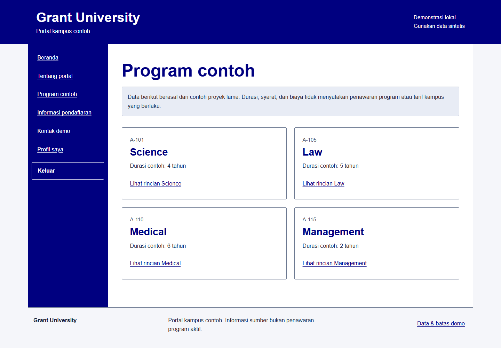
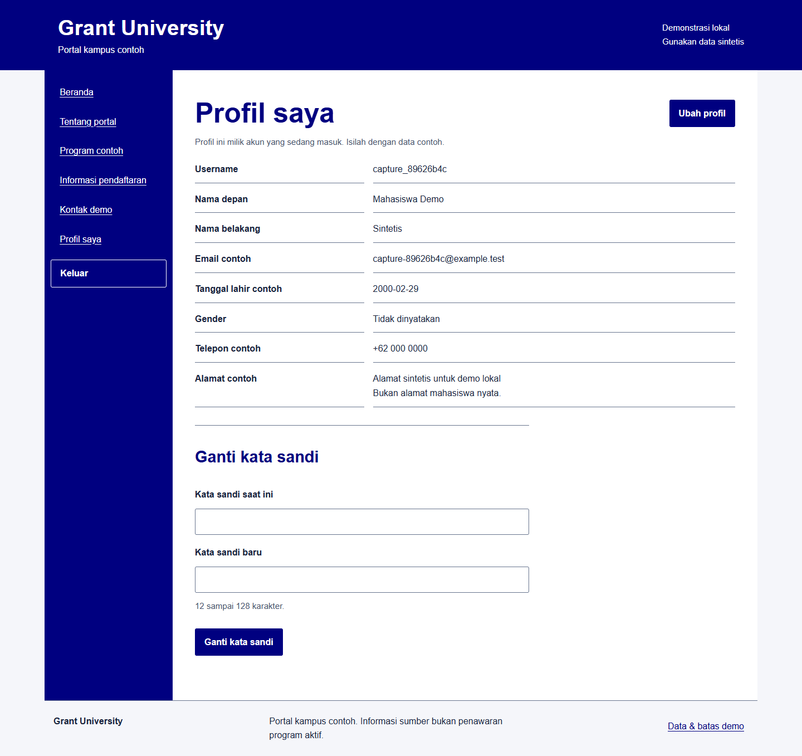

# Grant University Java

Portal kampus contoh dengan Java Servlet/JSP, JDBC, dan MySQL. Pengunjung membaca empat program latihan. Pengguna mendaftar akun, masuk, lalu membaca dan mengubah profilnya sendiri yang tersimpan di database.

Versi ini melanjutkan proyek NetBeans **Grant_University**. Nama, navy/putih, ilustrasi pendidikan, dan nilai program contoh dipertahankan. Implementasi JSF dengan login serta profil hardcoded dimodernisasi menjadi Servlet/JSP agar alur akun dapat dijalankan secara portabel. Portal ini tidak mewakili kampus atau penerimaan mahasiswa yang aktif.



*Program contoh dari sumber pada demo lokal yang dijalankan dengan Tomcat dan MySQL. Informasi ini bukan penawaran kampus aktif.*

<details>
<summary>Lihat profil milik akun demo</summary>



*Isian sintetis dari akun yang didaftarkan melalui antarmuka. Profil dibaca dari database berdasarkan akun yang sedang masuk.*

</details>

## Jalankan dengan Docker

Siapkan Docker Desktop dengan Linux containers dan Docker Compose. Java, Maven, dan MySQL tidak perlu dipasang pada host untuk cara ini. Jalankan bergantian dengan aplikasi database lain jika memori komputer terbatas.

```powershell
git clone https://github.com/zalamanga/grant-university-java.git
cd grant-university-java
Copy-Item .env.example .env
```

Isi `DB_PASSWORD` dan `DB_ROOT_PASSWORD` di `.env` dengan dua nilai berbeda. Jangan commit `.env`. Di macOS/Linux, ganti perintah salin dengan `cp .env.example .env`.

```powershell
docker compose up --build -d
docker compose ps
```

Setelah `db` dan `app` sehat, buka **http://127.0.0.1:18099**. Pilih Daftar akun demo dan isi semua kolom menggunakan data sintetis; tidak ada akun login bersama atau admin bawaan. Username menerima 4 sampai 40 huruf, angka, atau garis bawah. Kata sandi harus 12 sampai 128 karakter. Unduhan pertama memerlukan internet. `APP_PORT` dapat diubah jika port default sudah terpakai.

```powershell
docker compose logs --tail 80 app
docker compose stop
docker compose start
docker compose down
```

Aplikasi hanya membuka port loopback, dan port MySQL tidak dipublikasikan ke host. Data berada pada volume `database` dan tetap ada setelah `docker compose down`. Schema serta program contoh hanya dibuat saat volume baru diinisialisasi. Mengedit seed SQL tidak menimpa database yang sudah ada; mengganti password di `.env` tidak mengganti password pengguna MySQL yang sudah dibuat.

## Alur dan batas demo

| Alur | Perilaku |
| --- | --- |
| Program contoh | Daftar dan rincian Science, Law, Medical, dan Management dibaca dari database |
| Daftar akun | Validasi server, username/email unik, akun dan profil disimpan dalam satu transaksi |
| Masuk/keluar | Memakai akun yang didaftarkan, mengganti sesi setelah login, mengakhiri sesi saat logout |
| Profil saya | Hanya profil pemilik sesi yang ditampilkan; parameter ID dari browser tidak menentukan profil |
| Ubah profil | Nama, email contoh, tanggal lahir contoh, gender, telepon contoh, dan alamat contoh diperbarui di database |
| Ganti kata sandi | Memerlukan kata sandi saat ini dan menyimpan hash baru |

Durasi, syarat, serta biaya program mempertahankan nilai latihan dari `CourseDetailsBean.java` lama. Semuanya diberi label **contoh sumber**, bukan penawaran program, syarat penerimaan, atau tarif kampus yang berlaku. Tanggal penerimaan tahun 2011, sejarah kampus, jumlah mahasiswa/institusi, kontak, dan profil orang yang ditulis langsung di sumber tidak disajikan sebagai fakta aktual.

Pendaftaran membuat **akun demo**, bukan pengajuan kuliah. Tidak ada pembayaran, unggahan dokumen, verifikasi email/telepon, email keluar, jadwal penerimaan aktif, atau pemulihan password otomatis. Jika lupa password, buat akun demo baru dengan username dan email contoh berbeda. Tidak ada daftar mahasiswa publik atau halaman admin.

Database menyimpan seluruh isian profil contoh dan hash password. Gunakan data sintetis. Halaman Tentang portal menjelaskan penyimpanan tersebut. Pengelola instalasi dapat menghapus akun melalui database; profil terkait ikut terhapus. Tidak ada migrasi data/password lama.

## Build tanpa Docker

Siapkan **JDK 17, Maven 3.9, Tomcat 9, dan MySQL 8.4**:

```powershell
mvn -B -ntp clean verify
```

Hasilnya `target/grant-university-java.war`. Tes JUnit menguji hashing, batas password, validasi profil/tanggal, normalisasi input, dan perbandingan token CSRF tanpa database. Dockerfile menjalankan tes sebelum membuat image runtime.

Untuk deploy manual, buat database `grant_university`, impor `database/schema.sql`, lalu buat pengguna aplikasi dengan akses baca/tulis pada database itu. Atur environment pada proses Tomcat:

| Variabel | Isi |
| --- | --- |
| `DB_HOST`, `DB_PORT` | Default `127.0.0.1`, `3306` |
| `DB_NAME`, `DB_USER` | Default `grant_university`, `demo_app` |
| `DB_PASSWORD` | Password pengguna database aplikasi; wajib |

Tomcat tidak membaca `.env` otomatis. Deploy sebagai `ROOT.war` untuk URL tanpa context path atau gunakan nama WAR sebagai context path. Aplikasi memakai namespace `javax.servlet`; targetnya [Tomcat 9 dengan Servlet 4.0/JSP 2.3](https://tomcat.apache.org/tomcat-9.0-doc/index.html), bukan Tomcat 10/11 tanpa migrasi Jakarta. [Panduan MySQL Connector/J pada Tomcat](https://dev.mysql.com/doc/connector-j/en/connector-j-usagenotes-tomcat.html).

## Struktur dan perubahan teknis

```text
database/schema.sql             akun/profil baru dan empat program contoh
src/main/java/id/demo/          servlet, filter, repository, hashing, validasi
src/main/webapp/WEB-INF/views/  JSP di balik controller
src/main/webapp/assets/         CSS, JavaScript, education.jpg sumber
src/test/java/id/demo/          tes JUnit tanpa database
Dockerfile, compose.yaml        Tomcat 9 dan MySQL 8.4
```

Bean JSF request-scoped, login bersama, pencetakan password ke log, dan profil mahasiswa tetap diganti dengan controller Servlet, prepared statement, transaksi registrasi/profil, resource JDBC tertutup, serta batas akses berdasarkan sesi. Password memakai PBKDF2-HMAC-SHA256, salt acak, dan 600.000 iterasi. POST memerlukan token CSRF; cookie sesi memakai HttpOnly dan SameSite Lax. JSP meng-escape isi profil dan seluruh tampilan didekode sebagai UTF-8. Nama cookie `GRANT_UNIVERSITY_SESSION` menghindari benturan dengan demo Java lain.

`/health` memeriksa akses tabel program dan mengembalikan 200 atau 503. Jika data gagal dimuat/disimpan, periksa layanan database, kecocokan konfigurasi, dan log aplikasi. Daftar kosong menjelaskan bahwa program contoh perlu diisi kembali pada database demo.

Ini demo lokal. Penerapan publik masih memerlukan HTTPS/cookie Secure, pembatasan percobaan login, konfigurasi TLS database, kebijakan backup/retensi dan penghapusan profil, pemantauan, serta peninjauan operasional.

## Atribusi

Nama portal dan `Images/education.jpg` berasal dari sumber Grant_University dan gambar disalin tanpa perubahan isi. Tidak ditemukan Git remote, LICENSE, atau nama pembuat yang dapat dipastikan pada sumber lokal yang diaudit. Asal/lisensi gambar belum didokumentasikan. Modernisasi ini tidak mengklaim afiliasi kampus atau kepemilikan seluruh aset dan tidak menambahkan lisensi baru. Lihat [NOTICE](NOTICE).

## Alur kode

[Diagram alur, tanggung jawab file, dan batas penyimpanan](docs/CODE_FLOW.md).
