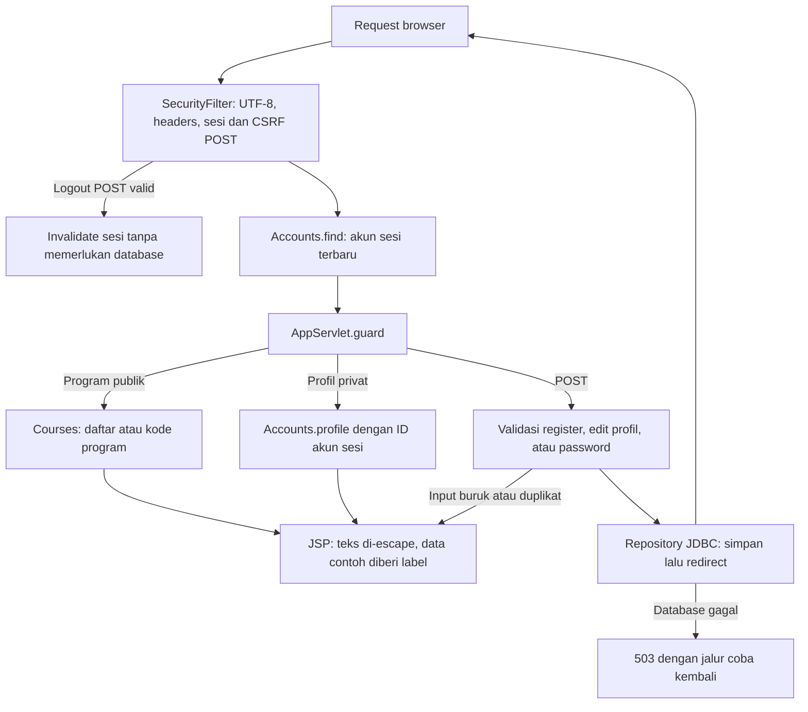

# Alur kode Grant University

Portal membaca program contoh dan menyimpan akun/profil per pengguna. Tomcat memuat driver dari WAR melalui `DriverLifecycle`; `Db` membuka koneksi berdasarkan environment proses.

## Registrasi dan perubahan profil

Registrasi memvalidasi username, password, dan seluruh profil sebelum mulai menulis. `Accounts.register` menyimpan akun lalu profil dalam satu transaksi. Bila penulisan gagal, perubahan dibatalkan. Login memverifikasi hash password dan mengganti sesi sebelum memasang `accountId`.

Pembacaan serta perubahan profil memakai ID akun dari sesi yang telah diverifikasi. Parameter ID yang dikirim browser tidak memilih pemilik profil. `updateProfile` memperbarui nama/email akun dan field profil dalam transaksi yang sama. Pergantian password membutuhkan password saat ini dan memakai hash lama dalam kondisi UPDATE untuk mendeteksi akun yang sudah berubah.

| Bagian | Sumber |
| --- | --- |
| Lifecycle driver dan koneksi | [DriverLifecycle.java](../src/main/java/id/demo/DriverLifecycle.java), [Db.java](../src/main/java/id/demo/Db.java) |
| Sesi dan CSRF | [SecurityFilter.java](../src/main/java/id/demo/SecurityFilter.java) |
| Route dan akses profil | [AppServlet.java](../src/main/java/id/demo/AppServlet.java) |
| Registrasi, profil dan password | [Accounts.java](../src/main/java/id/demo/Accounts.java), [Passwords.java](../src/main/java/id/demo/Passwords.java) |
| Validasi field dan tanggal | [Validation.java](../src/main/java/id/demo/Validation.java) |
| Query program contoh | [Courses.java](../src/main/java/id/demo/Courses.java) |
| Tampilan dan schema | [app.jsp](../src/main/webapp/WEB-INF/views/app.jsp), [schema.sql](../database/schema.sql) |
| Regresi domain | [DomainTest.java](../src/test/java/id/demo/DomainTest.java) |

Ini pendaftaran akun demo, bukan penerimaan mahasiswa atau pembayaran kuliah. Durasi/syarat/biaya program diberi label contoh sumber. Setup, screenshot dan data yang disimpan dijelaskan di [README](../README.md).
